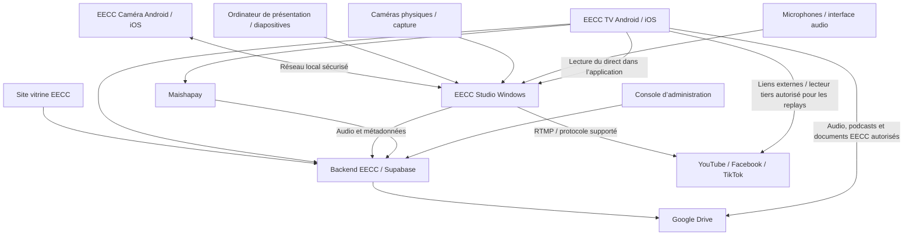
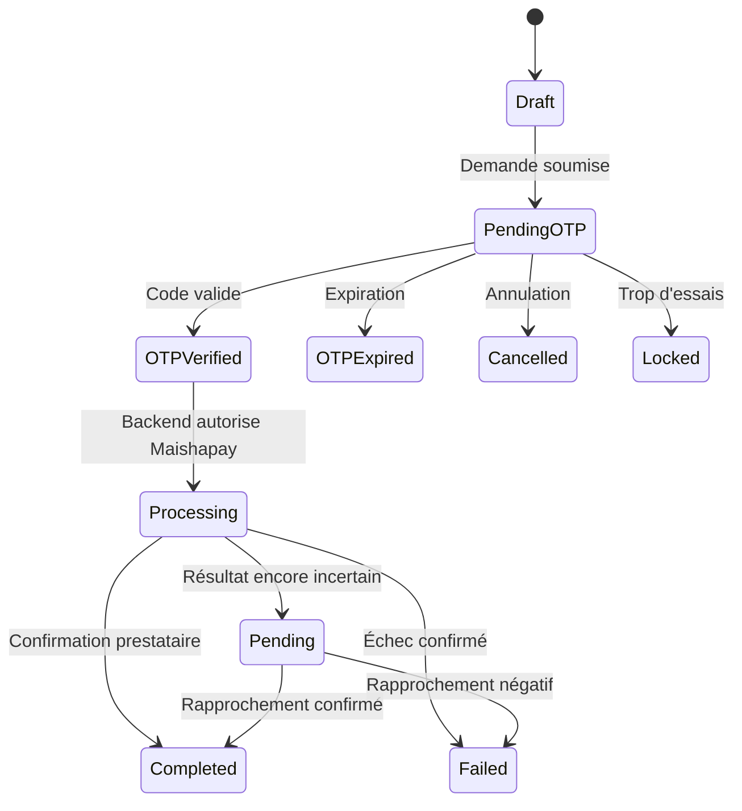

# EECC — Spécification fonctionnelle et technique de l’écosystème numérique de l’église

**Version :** 1.0 — document de cadrage détaillé  
**Statut :** base de conception à valider avant développement  
**Plateformes cibles :** site web, Windows, Android, iOS  
**Langue initiale :** français ; architecture prête pour d’autres langues  
**Nom de l’écosystème :** EECC  
**Applications :** EECC TV, EECC Caméra, EECC Studio

> Ce document décrit les comportements et l’interface attendus. Il ne prétend pas que les API de Maishapay, Google, Supabase, Facebook, YouTube, TikTok ou les projets cités possèdent toutes les capacités supposées. Les intégrations devront être validées avec leurs documentations, clés et comptes réels. Les applications tierces restent les systèmes de référence pour les diffusions et leurs enregistrements.

---

## 1. Vision, objectifs et principes

L’écosystème EECC doit relier la communication de l’église, la diffusion des cultes, la production audiovisuelle, la Bible, les dons et la médiathèque dans un ensemble cohérent.

### 1.1 Objectifs prioritaires

1. Présenter l’église, sa vision, ses responsables, ses lieux et ses activités sur un site vitrine.
2. Permettre aux fidèles de regarder les cultes en direct directement dans EECC TV, puis de retrouver les replays par leurs liens externes Facebook, YouTube, TikTok ou autres plateformes.
3. Fournir une régie Windows appelée EECC Studio, capable de réaliser une production vidéo/audio complète.
4. Transformer un téléphone Android ou iOS en caméra sans fil grâce à EECC Caméra et à un appairage par QR.
5. Recevoir des sources de caméras physiques, téléphones, ordinateur de présentation, fichiers vidéo, podcasts et diapositives.
6. Produire un mixage audio professionnel, enregistrer des pistes et préparer des contenus dérivés.
7. Centraliser les médias et documents dans Google Drive, avec Supabase pour les métadonnées, les comptes et les autorisations.
8. Permettre les dons via Maishapay, avec suivi transparent des frais et des retraits.
9. Publier podcasts, résumés de prédications et documents PDF, Word et TXT.
10. Garder une expérience fiable, accessible, sécurisée et utilisable dans des conditions réseau variables.

### 1.2 Principes non négociables

- **La diffusion reste indépendante des plateformes.** EECC Studio envoie le flux aux plateformes configurées. Facebook, YouTube, TikTok ou tout autre service conservent leurs propres enregistrements et contrôlent leur disponibilité.
- **EECC TV diffuse les cultes en direct dans l’application.** Pour les replays (cultes déjà terminés), EECC TV conserve et affiche les liens externes vers les plateformes qui hébergent ces vidéos — Facebook, YouTube, TikTok ou autres — et ouvre le replay dans le lecteur intégré autorisé ou dans l’application/le site tiers. EECC TV ne télécharge, ne copie ni n’héberge ces replays par défaut.
- **Aucune clé secrète dans les applications clientes.** Les secrets Maishapay, Supabase service-role, Google OAuth et les clés de diffusion sont protégés.
- **Consentement et droits.** Les personnes filmées, les œuvres musicales, les textes bibliques et les contenus partagés doivent être utilisés selon les autorisations applicables.
- **Résilience réseau.** Les fonctions locales de régie ne doivent pas dépendre d’une connexion Internet permanente.
- **Une seule source de vérité par domaine.** Supabase gère les données métier et le catalogue des cultes ; Google Drive conserve les fichiers EECC (notamment les pistes audio, podcasts et documents) ; les plateformes tierces conservent les vidéos de replay. EECC TV garde les URL/identifiants externes des replays, pas une copie vidéo de ces derniers.
- **Évolutivité.** Les modules peuvent être activés progressivement sans réécrire l’ensemble.

---

## 2. Architecture générale

### 2.1 Applications

| Composant | Système | Fonction |
|---|---|---|
| Site vitrine EECC | Web responsive | Informations officielles, actualités, horaires, contacts, dons, liens vers TV |
| EECC TV | Android et iOS | Lecture des cultes en direct dans l’application ; catalogue des replays avec liens externes Facebook, YouTube, TikTok et autres ; Bible, actualités, dons, podcasts |
| EECC Caméra | Android et iOS | Caméra mobile, audio, contrôle local, appairage QR |
| EECC Studio | Windows 10/11 64 bits | Régie, mixage, scènes, sources, diffusion, enregistrement audio, publication |
| Console d’administration | Web sécurisé | Gestion des contenus, utilisateurs, dons, programmation, paramètres |
| Backend EECC | Supabase + fonctions serveur | Authentification, métadonnées, politiques, tâches et webhooks |
| Stockage | Google Drive | Audio, podcasts, vidéos tierces importées/autorisées, documents |
| Paiements | Maishapay | Initiation, confirmation, rapprochement, remboursement si pris en charge |
| Plateformes de diffusion | YouTube, Facebook, TikTok, autres | Réception du flux en direct et hébergement de leurs propres replays |

### 2.2 Architecture logique



### 2.3 Flux média et contrôle

Séparer les flux de contrôle et les flux média :

- **Contrôle :** appairage, nom de source, batterie, niveau audio, commandes de caméra, état de connexion.
- **Média :** vidéo et audio transportés sur le réseau local.
- **Métadonnées :** identifiants de session, scène, source, horodatage, qualité, fichier créé.
- **Cloud :** synchronisation, sauvegarde, publication, dons, gestion des utilisateurs.

EECC Studio doit continuer à fonctionner en mode local si Supabase ou Internet est indisponible. La synchronisation s’effectue dès que le réseau revient.

---

## 3. Site vitrine EECC

### 3.1 Structure de navigation

En-tête principal :
- Logo EECC à gauche, cliquable vers l’accueil.
- Liens : **Accueil**, **À propos**, **Nos églises**, **Cultes**, **Actualités**, **Médiathèque**, **Bible**, **Faire un don**, **Contact**.
- Bouton principal **Regarder le direct**.
- Menu mobile « ☰ » avec panneau coulissant.

Pied de page :
- Logo et courte présentation.
- Adresse, téléphone, e-mail et horaires.
- Liens vers réseaux sociaux.
- Liens légaux : confidentialité, cookies, conditions d’utilisation.
- Bouton **Soutenir l’église**.
- Mention de copyright et année dynamique.

### 3.2 Écrans et contenus

#### Accueil
Sections dans cet ordre :
1. **Bannière héroïque** : image ou vidéo institutionnelle, titre « Bienvenue à l’EECC », phrase de mission, boutons **Découvrir l’église** et **Regarder le direct**.
2. **Direct actuel** : lecteur si un direct est actif ; sinon carte « Aucun direct en cours » avec prochain rendez-vous.
3. **Nos horaires** : jours, heures, lieu et lien d’itinéraire.
4. **Notre vision** : texte, image et lien vers la page À propos.
5. **Dernières prédications** : vignettes, titre, orateur, date, durée, bouton **Écouter** ou **Regarder**.
6. **Actualités et événements** : cartes chronologiques.
7. **Soutenir la mission** : explication des dons et bouton **Faire un don**.
8. **Newsletter** facultative avec consentement explicite.

#### À propos
- Histoire de l’église.
- Vision, mission et valeurs.
- Organisation et responsables.
- Déclaration de foi, si publiée officiellement.
- Photos institutionnelles avec texte alternatif.

#### Nos églises / implantations
- Carte ou liste des implantations.
- Nom, adresse, horaires, responsable, téléphone et lien d’itinéraire.
- Filtre par ville ou région.
- Ne pas afficher d’adresse personnelle non destinée au public.

#### Cultes
- Calendrier des cultes et événements.
- Filtres : direct, à venir, replay, prédication, podcast.
- Détail d’un culte : date, orateur, thème, versets, URL de replay externe (Facebook, YouTube, TikTok, etc.) et lien audio EECC éventuel.
- État du lien de replay externe clairement indiqué (disponible, non vérifié, inaccessible ou supprimé).

#### Actualités
- Liste paginée, catégories et recherche.
- Article : titre, auteur, date, image, corps, partage social.
- Bouton **Retour aux actualités**.

#### Médiathèque
- Catégories : prédications, podcasts, témoignages, annonces, événements.
- Recherche par thème, orateur, date et verset.
- Lecteur accessible et informations de durée.

#### Contact
- Formulaire : nom, e-mail/téléphone, sujet, message, consentement.
- Validation côté client et serveur, limitation anti-spam.
- Message de confirmation : « Votre message a été envoyé. »
- Coordonnées officielles et horaires.

### 3.3 États, animations et responsive

- Chargement : skeleton discret sur les cartes.
- Survol : légère élévation et transition d’ombre de 150–220 ms.
- Boutons : transition de couleur/échelle légère, sans animation excessive.
- Navigation mobile : tiroir latéral avec fermeture par bouton, clic extérieur et Échap.
- Respect de `prefers-reduced-motion`.
- Largeur mobile à partir de 320 px ; tablette ; bureau.
- Les contenus importants ne doivent jamais dépendre d’une animation pour être compris.

---

## 4. EECC TV — application publique Android et iOS

### 4.1 Navigation principale

Barre inférieure à cinq entrées :
1. **Accueil**
2. **Direct**
3. **Médiathèque**
4. **Bible**
5. **Profil**

Un bouton **Faire un don** est disponible depuis Accueil, Direct et Profil, sans encombrer la navigation principale.

### 4.2 Écran Accueil

- En-tête : logo EECC, salutation non personnalisée si l’utilisateur est déconnecté, icône notifications.
- Carte **Direct en cours** : vignette, badge « EN DIRECT », titre, nombre de spectateurs si la source le fournit, bouton **Regarder maintenant**.
- Si aucun direct : prochaine célébration avec date et heure.
- Rails horizontaux : **Dernières prédications**, **Podcasts**, **Replays à retrouver** (cartes avec liens externes), **Actualités EECC**.
- Carte de don avec bouton **Soutenir EECC**.
- Actualités officielles avec image et résumé.

### 4.3 Écran Direct et accès aux replays — règle fonctionnelle

**Le direct et le replay sont deux parcours distincts :**

- **Culte en direct :** EECC TV présente le flux live et le lit directement dans l’application au moyen du lecteur compatible. L’utilisateur n’a pas besoin de quitter EECC TV pour regarder le culte en cours.
- **Culte terminé / replay :** EECC TV n’héberge pas la vidéo de replay. L’application conserve dans son catalogue les URL et, si disponibles, les identifiants externes du replay sur Facebook, YouTube, TikTok ou toute autre plateforme utilisée. Le bouton **Regarder le replay** ouvre le lien dans un lecteur intégré seulement si l’intégration est permise et fiable ; sinon, il ouvre l’application tierce ou son site web.
- Les replays peuvent être référencés depuis les fiches de culte, les rails **Replays à retrouver**, la recherche et la médiathèque. Leur disponibilité dépend de la plateforme source.
- Si le lien est indisponible, privé, supprimé ou géobloqué, EECC TV affiche un état explicite et propose **Ouvrir sur la plateforme** ou **Réessayer**, selon le cas.
- EECC TV ne télécharge, ne copie ni ne réhéberge les vidéos tierces par défaut. Une copie n’est envisageable qu’avec autorisation et selon les droits applicables.

Éléments du lecteur de direct :
- Lecteur vidéo adaptatif, plein écran, rotation, contrôle du volume.
- Bouton lecture/pause.
- Sélecteur de qualité si le lecteur et la source l’autorisent.
- Sous-titres si disponibles.
- Bouton **Audio uniquement** si le flux le permet.
- Bouton **Partager**.
- Détail sous le lecteur : titre, date, orateur, thème, versets, description.
- Liste de contenus associés.
- État réseau : « Connexion… », « Débit faible », « Reconnexion… ».
- En cas d’indisponibilité : afficher un message utile et un bouton **Réessayer**, jamais un écran vide.

Fiche de replay :
- Miniature, titre du culte, date, orateur, thème et nom de la plateforme source.
- Bouton principal **Regarder le replay** qui utilise l’URL externe enregistrée.
- Action secondaire **Copier le lien** / **Partager**.
- Mention « Vidéo hébergée par [plateforme] » pour clarifier que la vidéo n’est pas stockée par EECC TV.

### 4.4 Médiathèque

- Onglets : **Tout**, **Prédications**, **Podcasts**, **Replays externes**, **Documents**.
- Recherche globale.
- Filtres : orateur, date, thème, durée, langue.
- Cartes : miniature, titre, orateur, date, durée, type et, pour un replay, plateforme source avec accès via son lien externe.
- Menu « … » : **Ajouter aux favoris**, **Partager**, **Signaler un problème**.
- Lecture continue optionnelle pour les podcasts.
- Historique local ou lié au compte selon consentement.

### 4.5 Bible intégrée

- Sélection de version, livre, chapitre et verset.
- Recherche par référence ou mots-clés.
- Navigation précédente/suivante.
- Taille de texte réglable.
- Mode nuit.
- Favoris et notes synchronisés pour les utilisateurs connectés.
- Copie/partage de référence et texte uniquement dans les limites de licence.
- Le catalogue des versions dépend des droits. Les versions non libres ne doivent pas être redistribuées sans licence.
- Source initiale envisagée : base de données biblique compatible, à auditer et attribuer.

### 4.6 Dons

Parcours :
1. Bouton **Faire un don**.
2. Écran de choix : montant prédéfini ou montant libre.
3. Devise clairement affichée, frais éventuels explicités avant validation.
4. Motif facultatif : offrande, mission, projet, soutien général.
5. Choix de moyen disponible dans Maishapay.
6. Écran de confirmation récapitulatif.
7. Redirection ou SDK Maishapay selon intégration approuvée.
8. Retour vers un écran **Don confirmé**, **En attente** ou **Échec**.
9. Reçu et référence de transaction si la passerelle les fournit.

Le statut final doit venir d’un webhook serveur vérifié ou d’une vérification serveur-à-serveur, jamais uniquement d’un écran de succès client. Éviter les doubles paiements grâce à une clé d’idempotence.

### 4.7 Profil et compte

- Connexion / création de compte facultative selon les fonctions.
- EECC TV peut autoriser la lecture publique sans compte.
- Profil : nom affiché, e-mail, préférences, favoris, historique, reçus de dons.
- Déconnexion, suppression du compte, export des données selon la politique applicable.
- Notifications push avec consentement et préférences par catégorie.

### 4.8 Accessibilité et interactions

- Cibles tactiles recommandées ≥ 44 × 44 points.
- Contraste conforme WCAG AA.
- Libellés accessibles pour icônes.
- Focus visible et lecteur d’écran.
- Animation d’entrée des cartes limitée à une opacité/translation douce.
- Transition entre onglets : 180–250 ms, réduite si le système le demande.

---

## 5. EECC Caméra — application mobile de caméra réseau

### 5.1 Fonction principale

L’application transforme le téléphone en source caméra pour EECC Studio. Elle ne doit pas prétendre remplacer les capacités optiques d’une caméra physique, mais proposer un contrôle et une transmission stables.

### 5.2 Écran d’accueil

- Logo EECC Caméra.
- Bouton principal **Connecter à EECC Studio**.
- Bouton **Utiliser comme caméra**.
- Sélecteur caméra avant/arrière.
- Indication des autorisations caméra, microphone et réseau local.
- Paramètres vidéo : résolution, fréquence d’images, orientation, stabilisation si prise en charge.
- Paramètres audio : micro intégré ou source autorisée, niveau et réduction de bruit optionnelle.

### 5.3 Appairage par QR

#### Dans EECC Studio
1. Ouvrir **Sources > Ajouter > EECC Caméra**.
2. Fenêtre **Connecter un téléphone**.
3. Afficher QR contenant un jeton temporaire, l’adresse locale du Studio et les paramètres de session.
4. Boutons **Renouveler le code**, **Copier le code**, **Annuler**.
5. Afficher le compte à rebours et l’état : « En attente du téléphone ».

#### Dans EECC Caméra
1. Appuyer sur **Scanner le QR code**.
2. Demander la permission caméra uniquement à ce moment.
3. Scanner le code.
4. Afficher le nom du Studio et la demande **Se connecter à [nom] ?**
5. Boutons **Connecter** et **Annuler**.
6. Après acceptation : état **Connecté**, aperçu local et paramètres de qualité.

Le QR ne doit contenir ni mot de passe permanent ni clé secrète. Le jeton expire rapidement, est à usage limité et est révoqué après appairage ou annulation.

### 5.4 Écran caméra active

- Aperçu plein écran.
- Bouton **Démarrer / Arrêter la transmission**.
- Bouton **Changer de caméra**.
- Bouton **Retourner l’image** si utile.
- Bouton **Verrouiller orientation**.
- Bouton **Réglages**.
- Indicateurs : connecté, qualité, débit, latence, batterie, température de l’appareil.
- Contrôle zoom selon l’API native.
- Contrôle mise au point/exposition si matériel compatible.
- Option **Écran sombre** qui garde la transmission active.
- Message d’avertissement en cas de batterie faible ou surchauffe.

### 5.5 Transport et qualité

- Favoriser un protocole média à faible latence compatible avec le Studio et le réseau local.
- Évaluer WebRTC ou un protocole de contribution équivalent ; ne pas figer le choix avant tests réseau et codecs.
- Négocier résolution et fréquence selon les capacités du téléphone.
- Profils indicatifs : 720p30, 1080p30, 1080p60 si matériel et réseau le permettent.
- Réduire le débit en cas de congestion ; afficher le changement.
- Reconnexion automatique avec backoff progressif.
- Audio et vidéo synchronisés ; horodatages monotones et contrôle de dérive.
- Transmission en Wi-Fi local recommandée ; avertir avant l’utilisation de données mobiles.

### 5.6 États et transitions

- `Idle` → `Scanning` → `Pairing` → `Connected` → `Streaming`.
- Échec d’autorisation : explication et bouton **Ouvrir les paramètres**.
- Perte réseau : bandeau **Connexion perdue — tentative de reconnexion**.
- Déconnexion : bouton **Reconnecter**.
- Les transitions doivent être courtes, non bloquantes et accessibles.

---

## 6. EECC Studio — régie Windows

### 6.1 Positionnement

EECC Studio est une application Windows autonome de production audiovisuelle inspirée des workflows de régie de type OBS Studio. Elle doit d’abord fournir une production stable, puis ajouter des outils de mixage et de postproduction audio plus avancés.

La compatibilité et les licences des projets de référence doivent être étudiées avant toute réutilisation de code. Les interfaces, marques et composants ne sont pas copiés sans analyse juridique.

### 6.2 Fenêtre principale

Disposition par défaut :

- **Barre de titre** : logo EECC Studio, nom du profil/projet, état de sauvegarde, minimiser, maximiser, fermer.
- **Menu supérieur** : Fichier, Édition, Affichage, Collection de scènes, Profil, Outils, Aide.
- **Zone centrale** : aperçu du programme.
- **Panneau Scènes** : scènes ordonnées.
- **Panneau Sources** : sources de la scène sélectionnée.
- **Panneau Mixeur audio** : canaux, vu-mètres, mute, volume, filtres.
- **Panneau Transitions** : transition active et durée.
- **Panneau Contrôles** : Démarrer le direct, Arrêter le direct, Enregistrer, Pause, Studio Mode, Paramètres.
- **Barre d’état** : CPU, mémoire, FPS, images perdues, débit sortant, état réseau, durée live/enregistrement.

Palette demandée : **70 % blanc, 20 % bleu-gris, 10 % noir**. Les couleurs d’état (rouge en direct, orange avertissement, vert prêt) restent limitées aux signaux fonctionnels.

### 6.3 Menu Fichier

- **Nouveau profil** : ouvre une boîte nom/description.
- **Ouvrir profil** : liste des profils récents.
- **Enregistrer profil** : sauvegarde paramètres et scènes.
- **Importer collection de scènes** : sélection de fichier, aperçu et confirmation.
- **Exporter collection de scènes** : export des scènes et références de médias, sans secrets.
- **Nouveau projet de culte** : assistant avec nom, date, événement, dossier de stockage.
- **Ouvrir projet récent**.
- **Quitter** : si live/enregistrement actif, confirmation explicite.

### 6.4 Scènes et sources

Une scène est un agencement de sources. Exemples de scènes préconfigurées :
- **Accueil / compte à rebours**
- **Orateur**
- **Louange**
- **Plan large**
- **Bible / verset**
- **Prédication**
- **Vidéo de présentation**
- **Pause**
- **Fin du culte**

Actions sur une scène :
- **+ Ajouter**, **Dupliquer**, **Renommer**, **Supprimer**.
- Réordonner par glisser-déposer.
- Transition vers scène par clic ou raccourci.
- Icône verrouillage pour empêcher les modifications accidentelles.
- Icône visibilité pour masquer la scène/source.

Types de sources :
- Caméra physique (USB/capture card).
- EECC Caméra (téléphone appairé).
- Micro/interface audio.
- Capture de fenêtre.
- Capture d’écran.
- Fichier vidéo/audio.
- Image.
- Diaporama ou source de présentation distante.
- Texte dynamique.
- Bible/verset.
- Navigateur/source web, si activé et sécurisé.
- Source NDI ou équivalent uniquement après validation de licence et de compatibilité.

Propriétés source :
- Nom, appareil, résolution, fréquence, format, latence.
- Transformation : position X/Y, largeur/hauteur, rotation, recadrage, ajustement/remplissage.
- Opacité, ordre, verrouillage.
- Boutons **Réinitialiser**, **Appliquer**, **Annuler**.
- Prévisualisation immédiate, sans altérer le programme tant que l’utilisateur n’applique pas en mode Studio.

### 6.5 Aperçu et Studio Mode

- **Aperçu** représente la prochaine scène.
- **Programme** représente le signal réellement diffusé.
- Bouton **Transition** applique la scène d’aperçu au programme.
- Bouton **Cut** : transition instantanée.
- Transition **Fondu**, **Balayage** et transitions personnalisées autorisées.
- Durée réglable en millisecondes ou secondes.
- Animation fluide, mais le changement doit rester déterministe.
- Le mode Studio peut être désactivé pour une interface simplifiée.

### 6.6 Contrôles de diffusion

Boutons et états :
- **Démarrer le direct** : ouvre la sélection des destinations et vérifie les paramètres.
- **Arrêter le direct** : confirmation si activée dans les préférences.
- **Enregistrer** : enregistrement local.
- **Pause** : disponible uniquement si le format et le moteur l’autorisent.
- **Reprendre**.
- **Studio Mode**.
- **Paramètres**.

Avant démarrage :
- vérifier sources, audio, résolution, encodeur, destinations et connexion.
- afficher les avertissements bloquants/non bloquants.
- bouton **Démarrer malgré les avertissements** seulement si la sécurité et les contraintes de la destination le permettent.

Pendant le live :
- indicateur rouge **EN DIRECT**.
- durée écoulée.
- débit par destination, état de connexion, images perdues.
- alerte si débit instable ou destination déconnectée.
- ne pas arrêter les autres destinations lorsqu’une seule échoue, sauf configuration explicite.

### 6.7 Destinations YouTube, Facebook, TikTok et autres

Écran **Paramètres > Diffusion > Destinations** :
- Liste des destinations configurées.
- **Ajouter une destination**.
- Nom convivial.
- Type de plateforme.
- URL serveur/ingest.
- Clé de diffusion ou identifiant nécessaire.
- Bouton **Afficher/masquer** la clé.
- Bouton **Tester** si un test non destructif est possible.
- **Enregistrer**, **Annuler**, **Supprimer**.
- Secret stocké dans le gestionnaire de secrets Windows, jamais dans les exports de profil.
- Aucune intégration API de plateforme n’est présumée. La configuration manuelle URL + clé est la base.
- Les exigences propres à chaque plateforme (codec, résolution, débit, droits, événements) doivent être vérifiées au moment de l’implémentation.
- Un même flux peut être envoyé à plusieurs destinations si le matériel et la bande passante le permettent. Le multistream peut utiliser un serveur relais externe, à documenter et chiffrer.

### 6.8 Audio professionnel intégré

Le module audio est une chaîne de production intégrée à la régie, avec fonctions inspirées d’une station audio numérique. Il ne doit pas être décrit comme un clone complet d’Audacity tant que les fonctions ne sont pas réellement développées.

#### Mixeur en direct
Canaux : micro 1, micro 2, instruments, audio ordinateur, audio caméra, retour vidéo, bus général.
- Vu-mètre crête et RMS/LUFS si disponibles.
- Bouton **Mute**.
- Fader de volume.
- Panoramique.
- Solo/PFL au casque.
- Groupe et bus.
- Routage vers programme, enregistrement, casque et bus auxiliaires.
- Étiquettes et couleur de canal.

#### Filtres par canal
Ordre configurable :
1. Gain d’entrée.
2. Filtre passe-haut.
3. Expander / noise gate.
4. Réduction de bruit.
5. Égaliseur paramétrique.
6. Compresseur.
7. De-esser optionnel.
8. Limiteur de sécurité.
9. Mesure de sortie.

Chaque filtre possède :
- interrupteur actif/inactif ;
- paramètres numériques et contrôles ;
- préréglages ;
- bouton **Réinitialiser** ;
- visualisation de courbe pour EQ ;
- réduction de gain pour compresseur/limiteur.

#### Postproduction audio
- Enregistrement audio séparé du flux vidéo.
- Enregistrement multipiste si l’architecture le permet.
- Vue forme d’onde.
- Sélection et découpage non destructif.
- Normalisation, fondu entrant/sortant, silence, gain, égalisation, compression et réduction de bruit.
- Export WAV/FLAC/MP3 selon codecs et licences.
- Annuler/rétablir.
- Historique des opérations.
- Ne pas écraser l’original : générer une version dérivée.
- Traitement en arrière-plan et barre de progression.

#### Sécurité audio
- Limiteur de bus maître.
- Alerte de clipping.
- Indication de latence.
- Ne pas appliquer un traitement destructif sans confirmation.
- Sauvegarde automatique du projet audio.

### 6.9 Enregistrement et projet de culte

À la création d’un projet :
- Nom de l’événement.
- Date et heure.
- Orateur.
- Thème.
- Références bibliques.
- Dossier local.
- Destination Google Drive.
- Préférences d’enregistrement.

Par défaut, enregistrer :
- piste vidéo programme locale si activée ;
- piste audio principale ;
- pistes audio isolées si configurées ;
- métadonnées de session ;
- journal des scènes et événements importants.

L’enregistrement local est distinct de la copie hébergée par les plateformes. Si le disque manque d’espace, avertir avant le live et appliquer une politique configurée, sans supprimer automatiquement un original important.

### 6.10 Diapositives et versets depuis une autre machine

Deux modes possibles :
- **Source de présentation distante** sur le réseau local.
- **Import de diapositives** dans Studio.

Fonctions :
- Afficher les diapositives reçues dans une liste miniature.
- Boutons **Précédent**, **Suivant**, **Afficher**, **Masquer**.
- Afficher le texte biblique, référence, titre ou points clés.
- Mode transparent/lower-third et mode plein écran.
- Position, taille, fond, couleur, police, alignement.
- Prévisualisation avant passage à l’antenne.
- Réception avec authentification locale, token de session et chiffrement quand possible.
- Si la source distante disparaît, conserver la dernière diapositive affichée et signaler la perte de connexion.

### 6.11 Publication de podcasts et documents

À la fin du culte, l’écran **Postproduction & publication** propose :
- **Créer un podcast audio**.
- **Créer une prédication vidéo** (lien vers la plateforme ou fichier autorisé).
- **Générer le résumé**.
- **Générer les notes de prédication**.
- **Exporter PDF**.
- **Exporter Word (.docx)**.
- **Exporter TXT**.
- **Envoyer vers Google Drive**.
- **Publier dans EECC TV**.
- **Programmer la publication**.

Le résumé automatique doit être présenté comme une proposition éditable, jamais comme une transcription parfaite ou une vérité théologique garantie. L’utilisateur relit et valide avant publication. Pour la transcription, indiquer la langue, les limites et le niveau de confiance lorsqu’ils sont disponibles.

### 6.12 Paramètres de Studio

Catégories :
- Général : langue, thème, confirmation, raccourcis.
- Apparence : disposition, taille, couleurs, densité.
- Audio : périphérique, fréquence d’échantillonnage, buffer.
- Vidéo : résolution de base/sortie, FPS.
- Encodeur : matériel/logiciel, preset, bitrate.
- Diffusion : destinations, clés, multistream.
- Enregistrement : format, chemin, pistes.
- Caméras : appairage, profils qualité.
- Google Drive : compte connecté, dossier racine, quota.
- Supabase : endpoint public et configuration cliente autorisée ; aucune clé service-role.
- Maishapay : intégration serveur, statut et environnement de test/production.
- Avancé : journaux, diagnostic, sauvegarde, reset.
- À propos : version, licences, mises à jour.

---

## 7. Google Drive et Supabase

### 7.1 Répartition des données

**Supabase :**
- utilisateurs et rôles ;
- profils publics ;
- métadonnées des cultes, sermons, podcasts, documents ;
- références de fichiers Drive ;
- état de synchronisation ;
- transactions et événements de paiement ;
- permissions, journaux d’audit ;
- configuration de programmation.

**Google Drive :**
- audio brut ;
- podcasts édités ;
- documents PDF/DOCX/TXT ;
- médias tiers importés avec autorisation ;
- fichiers de production et exports.

**Plateformes de streaming :**
- flux en direct et replays qu’elles hébergent ;
- EECC conserve leurs identifiants/URLs et métadonnées autorisées, non une copie non autorisée.

### 7.2 Organisation recommandée de Drive

```text
EECC/
  Cultes/
    2026/
      2026-11-08_Culte-Dimanche/
        Audio/
          original.wav
          podcast_final.mp3
        Documents/
          resume.pdf
          resume.docx
          resume.txt
        Video/
          exports_autorises/
        Metadata/
          session.json
  Podcasts/
  Mediatheque/
  Documents_Eglise/
  Archives/
```

### 7.3 Synchronisation

- Upload en arrière-plan avec reprise.
- Vérification de taille, checksum et type MIME.
- Statuts : local, en attente, en cours, synchronisé, erreur, conflit.
- Réessai exponentiel.
- Boutons **Réessayer**, **Ouvrir le dossier**, **Voir le détail**.
- Aucun fichier ne doit être considéré synchronisé avant confirmation du serveur.
- Politique de rétention configurable.
- Quota Drive visible dans l’interface.
- Les suppressions cloud nécessitent une permission et une confirmation.

### 7.4 Supabase — sécurité

- Row Level Security activée sur les tables exposées.
- Rôles : visiteur, fidèle, éditeur média, régisseur, trésorier, administrateur.
- Politique de moindre privilège.
- Les clés publiques peuvent être utilisées dans les clients si RLS est correctement configurée.
- Les clés privilégiées restent dans les fonctions serveur.
- Journaliser les actions administratives et les changements financiers.
- Prévoir sauvegardes, migrations et restauration testée.

---

## 8. Maishapay, dons et retraits

### 8.1 Architecture de paiement

1. Client demande une intention de paiement.
2. Backend EECC crée une transaction avec référence unique et montant.
3. Backend appelle Maishapay avec les secrets conservés côté serveur.
4. Le client affiche l’interface/URL/SDK de paiement autorisée.
5. Maishapay renvoie un événement serveur ou le backend vérifie le statut.
6. Le backend valide signature, montant, devise, référence et statut.
7. La transaction EECC passe à **confirmée**, **en attente**, **échouée** ou **remboursée**.
8. Le reçu est généré et affiché.

### 8.2 Écran Trésorerie / Studio

Accessible uniquement au rôle autorisé :
- Total collecté par période.
- Montants par canal de paiement.
- Transactions en attente.
- Frais affichés selon les données réelles Maishapay.
- Solde disponible, si Maishapay expose cette information.
- Historique des retraits.
- Bouton **Demander un retrait** si l’API l’autorise.
- Choix mobile money/carte uniquement selon les moyens réellement supportés.
- Récapitulatif montant brut, frais, montant net, destination et délai estimé.
- Confirmation à deux étapes pour les opérations sensibles.
- Export CSV/PDF des rapports.

### 8.3 Règles de transparence

- Ne pas supposer que tous les frais sont supportés ou calculables par EECC.
- Distinguer frais de paiement, frais de retrait, montant brut et montant net.
- Le paiement d’un don et le retrait de fonds sont deux opérations différentes.
- La carte peut être un moyen de paiement ou de retrait selon le service ; ne pas les confondre.
- Toute opération financière doit être rapprochée avec le relevé Maishapay.
- Ne jamais enregistrer les numéros complets de carte ou les codes secrets.

---

## 9. Console d’administration

### 9.1 Accueil / tableau de bord

Widgets :
- Prochains cultes.
- Direct actif et état des destinations.
- Derniers médias publiés.
- Fichiers Drive en erreur.
- Transactions en attente.
- Activité récente.
- Actions rapides : **Créer un événement**, **Publier un média**, **Ajouter une actualité**, **Voir les dons**.

### 9.2 Gestion de contenu

Pour chaque objet :
- liste avec recherche, filtres et pagination ;
- création/édition ;
- aperçu ;
- statut brouillon, programmé, publié, archivé ;
- historique des modifications ;
- confirmation de suppression ;
- contrôle de permission.

### 9.3 Rôles et permissions

| Rôle | Accès |
|---|---|
| Visiteur | Pages publiques et contenus publics |
| Fidèle | Favoris, notes, reçus personnels, préférences |
| Éditeur | Actualités, podcasts et documents assignés |
| Régisseur | Scènes, diffusion, médias du culte |
| Trésorier | Transactions, rapports et retraits |
| Administrateur | Gestion globale, rôles, paramètres |

Le rôle administrateur ne doit pas automatiquement donner accès aux données de carte ou secrets de paiement.

---

## 10. Modèle de données indicatif

Tables à adapter lors de la conception Supabase :

- `profiles`: id, display_name, email, avatar, locale, created_at.
- `roles` / `profile_roles`: rôles et affectations.
- `church_locations`: nom, adresse publique, horaires, coordonnées publiques.
- `events`: titre, description, date, lieu, type, statut.
- `sermons`: titre, speaker, date, theme, scripture_refs, summary, event_id.
- `media_assets`: title, type, drive_file_id, mime_type, size, checksum, visibility, status.
- `platform_replays`: platform, external_id, url, event_id, availability_status (catalogue de références externes ; la vidéo replay reste hébergée par la plateforme source).
- `podcasts`: sermon_id, media_asset_id, duration, publication_status.
- `bible_versions`, `bible_books`, `bible_verses`: uniquement selon licence et provenance.
- `donation_intents`: reference, donor_id nullable, amount, currency, status.
- `payment_events`: provider_event_id, signature_valid, event_type, received_at.
- `withdrawals`: provider_reference, amount, fee, net_amount, status.
- `drive_sync_jobs`: asset_id, status, retries, last_error.
- `audit_logs`: actor_id, action, target, timestamp, metadata.
- `notifications`: user_id, type, payload, read_at.

Ne pas placer des informations personnelles sensibles dans les journaux ou métadonnées inutiles.

---

## 11. Notifications

Catégories :
- Direct bientôt disponible.
- Direct en cours.
- Nouvelle prédication/podcast.
- Actualité de l’église.
- Confirmation de don ou reçu.
- État d’un upload ou d’une publication pour les rôles autorisés.

Chaque catégorie dispose d’un interrupteur. Notifications marketing/informatives distinctes des reçus et alertes de sécurité. Le système doit respecter les permissions du téléphone et les préférences du compte.

---

## 12. États globaux, messages et animations

### 12.1 États standard

Pour toute liste ou action réseau :
- Chargement : indicateur/skeleton.
- Vide : explication et action utile.
- Succès : confirmation brève.
- Erreur : cause compréhensible, code de diagnostic facultatif, bouton de réessai.
- Hors ligne : état explicite et fonctions locales disponibles.
- Accès refusé : indiquer la permission nécessaire sans exposer de données.

### 12.2 Textes d’interface recommandés

- « Connexion en cours… »
- « Votre session est prête. »
- « Aucun contenu pour le moment. »
- « Le direct n’est pas disponible actuellement. »
- « Connexion instable. Réduction de la qualité… »
- « Fichier synchronisé avec Google Drive. »
- « Synchronisation interrompue. Réessayer »
- « Don confirmé. Merci pour votre soutien. »
- « Le paiement est en attente de confirmation. »
- « Vous êtes sur le point d’arrêter la diffusion. Continuer ? »
- « Cette action ne peut pas être annulée. »

### 12.3 Motion design

- Durées usuelles : 150–250 ms pour micro-interactions ; 200–300 ms pour navigation.
- Easing doux, cohérent.
- Éviter les animations en boucle dans les écrans de régie.
- Le direct et les vu-mètres doivent privilégier la lisibilité et la performance.
- Respecter les réglages d’accessibilité du système.

---

## 13. Sécurité, confidentialité et conformité

- HTTPS/TLS pour toutes les communications cloud.
- Chiffrement des secrets de diffusion au repos via coffre système.
- QR de caméra à durée de vie courte et usage limité.
- Authentification locale entre téléphone et Studio.
- Protection contre rejeu et usurpation de source.
- Permissions caméra/micro demandées au moment utile.
- RLS Supabase et tests automatisés des politiques.
- Webhooks Maishapay authentifiés et idempotents.
- Limitation de débit sur login, contact, dons et endpoints publics.
- Journaux sans secrets, mots de passe, clés ou données de carte.
- Consentement explicite pour notifications, analytique et données facultatives.
- Politique de conservation et suppression documentée.
- Prévoir procédures de réponse aux incidents et rotation de clés.
- Vérifier obligations locales et conditions des prestataires avant mise en production.

---

## 14. Performance et fiabilité

### 14.1 EECC Studio
- Prévoir accélération matérielle d’encodage lorsque disponible.
- Afficher FPS, temps d’encodage, débit et pertes.
- Limiter les copies mémoire inutiles entre sources.
- Tester les scènes complexes et le multistream.
- Éviter de bloquer l’interface pendant encodage, upload ou analyse audio.
- Autosauvegarde de profil/projet.

### 14.2 Applications mobiles
- Lecture adaptative et cache des métadonnées.
- Téléchargement audio uniquement si autorisé.
- Reconnexion réseau et reprise de lecture.
- Réduire la consommation batterie en arrière-plan.
- La caméra mobile doit signaler surchauffe, batterie et qualité.

### 14.3 Backend
- Pagination des catalogues.
- Index sur date, statut, speaker, event_id et références.
- Tâches asynchrones pour génération et synchronisation.
- Sauvegardes et restauration testée.
- Monitoring des erreurs, latences et webhooks.

---

## 15. Tests et critères d’acceptation

### 15.1 Site vitrine
- Navigation complète sur mobile et bureau.
- Contenus administrables.
- Formulaire validé, protégé contre spam et accessible.
- Direct actif/inactif reflété correctement.

### 15.2 EECC TV
- Lire le culte en direct directement dans EECC TV.
- Afficher un replay comme lien externe Facebook/YouTube/TikTok (ou autre plateforme) et ouvrir le lien selon les possibilités autorisées ; ne pas stocker de copie vidéo du replay dans EECC TV.
- Gérer absence de réseau et reprise.
- Rechercher prédications et podcasts.
- Changer version biblique si disponible et licenciée.
- Dons : confirmation exclusivement par vérification serveur.
- Favoris et préférences synchronisés pour compte connecté.

### 15.3 EECC Caméra
- QR expiré refusé.
- Appairage valide réussi.
- Refus d’autorisation expliqué.
- Flux audio/vidéo stable sur Wi-Fi dans les scénarios de test.
- Perte et reprise réseau gérées.
- Déconnexion sécurisée.

### 15.4 EECC Studio
- Ajouter, déplacer, masquer et verrouiller une source.
- Changer de scène avec Cut et Fondu.
- Mixage audio sans clipping dans le scénario de référence.
- Démarrer et arrêter chaque destination indépendamment.
- Enregistrer une piste audio locale pendant un live.
- Importer les diapositives d’une machine distincte.
- Générer et modifier un résumé avant publication.
- Synchroniser les fichiers Drive et reprendre après coupure.
- Les clés ne figurent pas dans les exports ou logs.

### 15.5 Paiements
- Paiement confirmé, en attente, échoué, annulé et webhook dupliqué.
- Montant/devise/référence invalides rejetés.
- Aucun statut confirmé par le seul client.
- Rapports de rapprochement cohérents.

### 15.6 Matrice de tests
- Windows 10 et Windows 11 64 bits.
- Android : versions minimales à définir selon parc cible.
- iOS : versions minimales à définir selon parc cible.
- Wi-Fi local avec et sans Internet.
- Débit réseau variable, perte de paquets, coupure longue.
- Caméra USB, carte de capture, téléphone récent et appareil de gamme moyenne.

---

## 16. Plan de réalisation recommandé

### Phase 0 — validation
- Valider identité visuelle, rôles, langues, versions bibliques et règles de dons.
- Vérifier les API Maishapay et Google Drive.
- Vérifier licences des projets de référence et codecs.
- Définir protocoles de caméra et de présentation distante.

### Phase 1 — socle
- Backend Supabase, schéma, RLS, environnements.
- Site vitrine.
- Catalogue de cultes et médias.
- Console admin minimale.

### Phase 2 — EECC TV
- Accueil, lecteur, médiathèque, Bible selon licences.
- Authentification facultative et favoris.
- Dons en environnement de test.

### Phase 3 — EECC Studio de base
- Scènes, sources, aperçu, transitions, audio de base.
- Diffusion à une destination.
- Enregistrement local.
- Profils et collections.

### Phase 4 — EECC Caméra
- QR sécurisé.
- Flux vidéo/audio local.
- Reconnexion et qualité adaptative.
- Intégration Studio.

### Phase 5 — multi-destinations et production
- Destinations supplémentaires.
- Diapositives distantes.
- Mixeur avancé, filtres et multipiste.
- Postproduction audio.

### Phase 6 — cloud et publication
- Drive, synchronisation, podcasts.
- Résumés et exports PDF/DOCX/TXT.
- Publication EECC TV et programmation.

### Phase 7 — trésorerie et lancement
- Maishapay production, rapprochement, rapports et retraits autorisés.
- Tests de sécurité, charge, restauration et conformité.
- Bêta auprès d’une équipe de régie, puis déploiement progressif.

---

## 17. Décisions à confirmer avant développement

1. Nom officiel complet de l’église et textes institutionnels.
2. Logo, polices, palette définitive et règles de marque.
3. Langues initiales et langues de prédication.
4. Versions bibliques souhaitées et licences disponibles.
5. Politique de lecture sans compte, favoris et historique.
6. Modèle de dons : anonyme ou identifié, reçus, projets.
7. Compte Maishapay et fonctions réellement activées : collecte, mobile money, carte, retrait.
8. Compte Google Workspace/Drive, quota et propriétaire des fichiers.
9. Protocole de caméra et de présentation distante.
10. Résolutions, FPS, bitrate et encodeurs ciblés.
11. Politique de conservation des enregistrements locaux.
12. Besoin d’une copie vidéo locale ou seulement audio + replay tiers.
13. Conditions de modération et publication des résumés.
14. Hébergement du backend, domaines et procédures de sauvegarde.

---

## 18. Références de départ et limites

Projets indiqués par le demandeur :
- OBS Studio : https://github.com/obsproject/obs-studio
- Jellyfin : https://github.com/jellyfin/jellyfin
- REA : https://github.com/morluto/rea/tree/main
- Audacity : https://github.com/audacity/audacity
- StreamAssistant Camera : https://github.com/prgmitchell/streamassistant-camera/
- Bible databases : https://github.com/scrollmapper/bible_databases

Ces projets sont des références fonctionnelles et techniques, pas une garantie de compatibilité ou une autorisation automatique de réutilisation. Avant de reprendre du code, examiner la licence, les dépendances, la maintenance, la sécurité, les plateformes supportées et les obligations de redistribution. Jellyfin, OBS, Audacity et les autres projets ont des périmètres différents ; il faudra choisir les composants à intégrer, adapter ou réimplémenter. Une application Flutter pour mobile et un logiciel Windows de régie peuvent partager des contrats API et du code métier, mais le moteur média natif peut nécessiter des composants spécifiques à chaque plateforme.

---

## 19. Résumé de l’expérience attendue

Le fidèle ouvre EECC TV ou le site, trouve le direct, les prédications, les podcasts, les actualités et la Bible, puis peut faire un don dans un parcours clair. Le régisseur ouvre EECC Studio, assemble les caméras physiques, les téléphones appairés par QR, les micros, les diapositives et les médias, mixe l’audio, prépare les scènes et diffuse vers les plateformes. À la fin du culte, l’audio est sauvegardé, synchronisé dans Drive, puis les podcasts et documents sont préparés et publiés après validation humaine.

**La priorité absolue est une régie stable, un parcours de don fiable, une médiathèque claire et une séparation correcte entre les fichiers EECC et les replays hébergés par les plateformes tierces.**


---

## 20. Précisions confirmées sur les intégrations et l’authentification des retraits

Le porteur du projet dispose déjà des accès/API nécessaires pour **Maishapay, Supabase, Google et Brevo**. Le développement devra donc prévoir leur intégration réelle dans les environnements de test puis de production, au lieu de présenter ces services comme de simples options futures. Les clés et secrets ne doivent toutefois pas être insérés directement dans le code source, le dépôt Git ou les applications clientes.

### 20.1 Configuration des services

Dans la console d’administration et/ou les paramètres sécurisés d’EECC Studio, prévoir les intégrations suivantes :

- **Maishapay** : création et vérification des paiements, consultation des transactions et opérations de retrait uniquement si les API et permissions du compte le permettent.
- **Supabase** : authentification, base de données, politiques d’accès, métadonnées et fonctions serveur.
- **Google** : autorisation OAuth pour Google Drive et synchronisation des fichiers vers le compte/dossier choisi.
- **Brevo** : envoi des codes OTP par e-mail aux administrateurs autorisés.

Les paramètres publics non sensibles peuvent être exposés aux clients quand nécessaire. Les secrets Maishapay, secrets Brevo, clés privilégiées Supabase et jetons Google doivent être stockés côté serveur ou dans un coffre sécurisé. Dans EECC Studio Windows, les secrets locaux éventuels doivent utiliser le Gestionnaire d’identifiants Windows ou un stockage équivalent chiffré.

### 20.2 Adresse e-mail de sécurité dans EECC Studio

Dans **Paramètres > Sécurité et trésorerie > Authentification des retraits**, l’administrateur autorisé peut :

- renseigner l’adresse e-mail de réception des OTP ;
- afficher l’adresse partiellement masquée après enregistrement, par exemple `ad***@exemple.com` ;
- demander la vérification de cette adresse ;
- remplacer l’adresse après une nouvelle vérification et, si nécessaire, une approbation administrative ;
- consulter l’état **Non vérifiée**, **Vérifiée** ou **À confirmer**.

L’adresse e-mail est un paramètre de sécurité sensible. Sa modification ne doit pas permettre de contourner l’authentification du retrait. Un changement d’adresse peut exiger une nouvelle connexion, un OTP à l’ancienne adresse ou une procédure de récupération administrateur.

### 20.3 Parcours obligatoire avant tout retrait

L’OTP par e-mail est une étape de confirmation supplémentaire, déclenchée avant l’exécution d’un retrait. Le parcours recommandé est :

1. L’utilisateur ouvre **Trésorerie > Retraits**.
2. Le logiciel vérifie sa session, son rôle et les permissions de retrait.
3. L’utilisateur choisit le moyen de retrait disponible, renseigne la destination autorisée et le montant.
4. Le logiciel affiche un récapitulatif : montant brut, frais connus, montant net estimé, devise, destination masquée et référence.
5. L’utilisateur clique sur **Continuer vers la vérification**.
6. Le backend crée une demande de retrait en état `pending_otp`, liée à l’utilisateur, au montant, à la devise et à la destination.
7. Le backend génère un code OTP **de 5 caractères**, puis l’envoie à l’adresse e-mail vérifiée via Brevo.
8. EECC Studio affiche l’écran **Vérification de sécurité** :
   - titre : « Confirmez votre retrait » ;
   - texte : « Un code de vérification a été envoyé à [adresse masquée]. Saisissez le code de 5 caractères pour continuer. » ;
   - champ de code en 5 cases ou champ unique de 5 caractères ;
   - bouton **Vérifier et confirmer le retrait** ;
   - bouton **Renvoyer le code** avec délai d’attente ;
   - bouton **Annuler le retrait** ;
   - indication de l’expiration du code.
9. Le backend vérifie le code, son expiration, le nombre d’essais, la demande et l’utilisateur.
10. En cas de succès, le backend marque la vérification comme validée et exécute ou autorise l’exécution du retrait via Maishapay, selon le flux réellement offert par l’API.
11. L’écran affiche **Retrait confirmé**, **Retrait en cours** ou **Retrait refusé**, uniquement selon le résultat confirmé par le serveur/prestataire.
12. La demande, l’événement OTP et le résultat du retrait sont inscrits dans le journal d’audit.

**Règle fondamentale :** le client Windows ne doit jamais décider seul qu’un code est valide ni envoyer directement une instruction de retrait privilégiée. La vérification OTP et l’appel de retrait doivent être effectués par un backend protégé.

### 20.4 Format et sécurité de l’OTP

- Longueur : exactement **5 caractères**.
- Utiliser un générateur cryptographiquement sûr.
- Pour un code numérique, autoriser les zéros initiaux et stocker le code comme une chaîne, pas comme un nombre.
- Si le besoin « 5 caractères » signifie alphanumérique, utiliser un alphabet clair et exclure les caractères ambigus (par exemple `O/0` et `I/1`) ; ce choix doit être fixé dans la configuration.
- Durée de validité courte, recommandation initiale : 5 minutes, à confirmer par la politique de sécurité.
- Un code ne peut être utilisé qu’une seule fois et doit être invalidé après validation.
- Limiter les tentatives, par exemple à 5 essais par demande, puis invalider le code et imposer une nouvelle demande.
- Limiter les envois et renvois par compte, adresse, appareil et fenêtre de temps afin de prévenir l’abus.
- Le bouton de renvoi applique un délai d’attente visible et invalide l’ancien code selon une règle cohérente.
- Ne jamais écrire le code en clair dans les logs, analytics, base de données ou messages de diagnostic.
- Stocker une empreinte sécurisée du code côté serveur, avec contexte et expiration.
- Ne pas révéler si une adresse non autorisée ou un compte donné existe.
- Un code expiré, incorrect, déjà utilisé ou lié à une autre demande doit être refusé.

### 20.5 Modèle d’états du retrait



Un résultat réseau ambigu ne doit pas provoquer un deuxième retrait automatique. Le backend doit vérifier la référence/idempotence auprès de Maishapay avant toute nouvelle tentative.

### 20.6 Notifications et journal d’audit

E-mails Brevo à prévoir :
- **Code de confirmation de retrait** : code, durée de validité, montant et devise, destination partiellement masquée, rappel « Si vous n’êtes pas à l’origine de cette demande, contactez l’administrateur de l’église ».
- **Retrait confirmé** : référence, montant, frais connus et statut.
- **Demande de retrait annulée ou expirée** : statut et référence.
- **Modification de l’adresse OTP** : notification à l’ancienne et/ou nouvelle adresse selon la procédure de sécurité.

Le journal d’audit conserve au minimum :
- identifiant de l’acteur ;
- référence de la demande ;
- date et heure ;
- action (création, envoi OTP, validation, échec, annulation, retrait) ;
- statut et référence Maishapay ;
- informations techniques limitées utiles à la sécurité.

Il ne conserve jamais le code OTP, les secrets d’API, les données complètes de carte ou un jeton d’accès.

### 20.7 Critères d’acceptation spécifiques

- Aucun retrait ne peut être déclenché sans OTP validé pour la demande concernée.
- Un code expiré, erroné, réutilisé ou associé à une autre demande est refusé.
- Le code est envoyé à l’adresse vérifiée et masquée dans l’interface.
- Les tentatives et renvois sont limités côté serveur.
- Les erreurs Brevo sont affichées sans exposer les détails secrets du fournisseur.
- Un double clic ou une répétition réseau ne crée pas deux retraits.
- L’état final reflète une confirmation serveur Maishapay, pas uniquement l’écran de l’application.
- Les permissions du rôle trésorier et les journaux d’audit sont testés.

